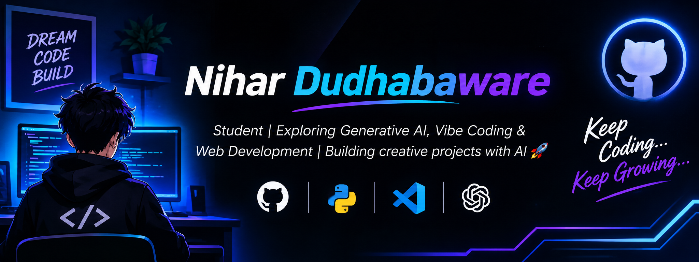

  

  

<h1 align="center">⚡ NIHAR DUDHABAWARE</h1>

<h3 align="center">AI ENTHUSIAST • VIBE CODER • TECH EXPLORER</h3>

  

  
  

---

## 👨‍💻 ABOUT ME

- 🤖 Interested in Artificial Intelligence
- ⚡ Exploring Vibe Coding
- 🌐 Exploring AI-assisted Web Development
- 🧠 Learning about Generative AI
- 🚀 Building creative digital projects
- 🎯 Always exploring new technology

---

## ⚡ TECHNOLOGY & INTERESTS

  
  
  
  
  

---

## 🏆 CERTIFICATION

**IBM — Generative AI Essentials: From Fundamentals to Real-World Applications**

📅 June 24, 2026

🔗 [Verify IBM Certificate](https://coursera.org/verify/GVHZHM9VG6X8)

---

## 🚀 FEATURED PROJECTS

| Project | Description |
|---|---|
| [🎮 MultiGames](https://multigames-rho.vercel.app) | A collection of online games |
| [🌐 Nihar Gaming Zone](https://nihar-gaming-zone.vercel.app) | Gaming website |
| [💬 Messaging App](https://nihar-msg.vercel.app) | Messaging app project |
| [🍽️ Restaurant Website](https://restaurent-neon.vercel.app) | Fictional restaurant website demo |

---

## 📊 GITHUB ANALYTICS

  

  

  

---

### ⚡ THINK • CREATE • INNOVATE

*Learning today. Building tomorrow.*

**Thanks for visiting my profile!**

